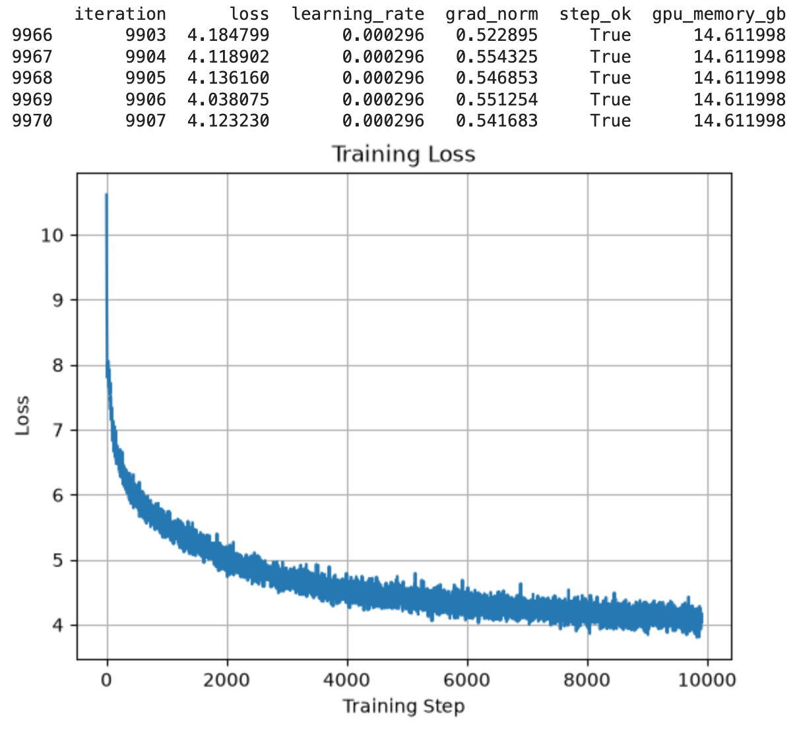
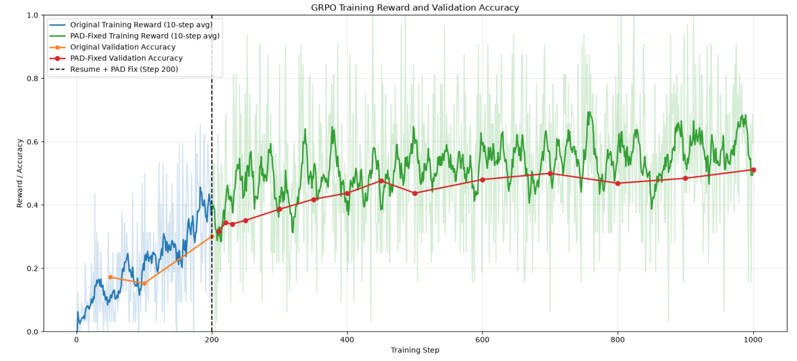
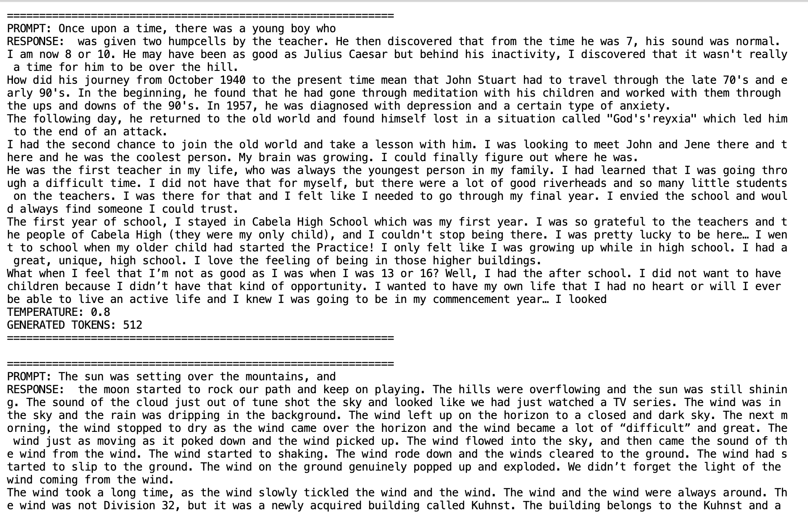
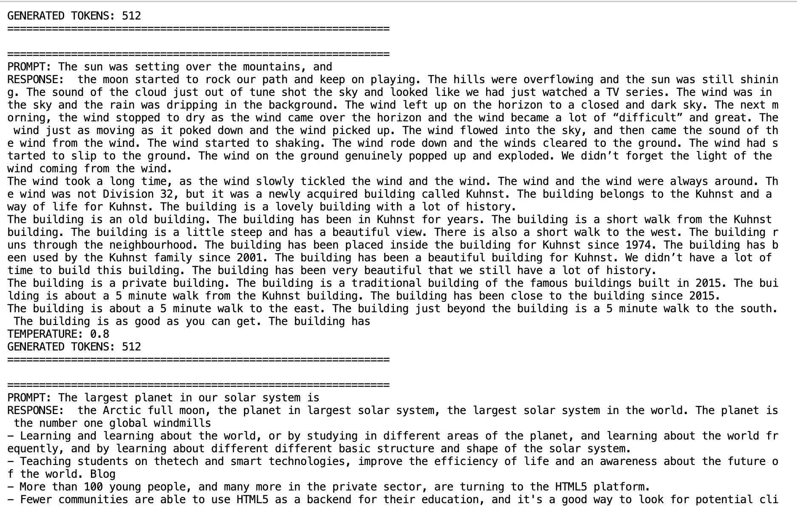
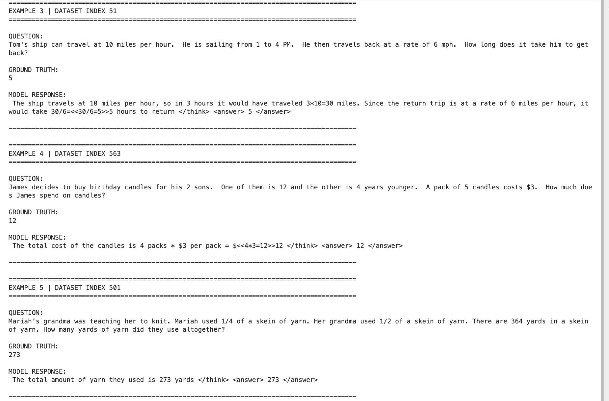

# LLM 1 Billion lab
A hands-on, modular repo to pretraining, scaling, and aligning a 1B LLM model from scratch. dataset is fineWeb for internet data and Grade School Math 8K for alignment RL model. Distrubuted training DP, TP, FSDP(Zero3 sharding). Includes implementation of Jit kernels and Custom Autograd Fuction. Also Exploring Memory optimization techniques like Fusion Operations and recomputation. 

# Content
```text
1. transformer_from_scratch_01
2. tokenizer_02
3. dataset_03
4. ddp_05
5. fsdp_06
6. megatron_07
8. grpo_08
```

# Training Figure
<p align="center">
	1. Base model training loss
	
</p>
<p align="center">
	2. Alignment RL training loss
	
	
</p>

# Generation Results

1. Base model output. Language Flow, Understanding structure and creating base knowledge
<p align="center">
  
  
</p>

2. Alignment RL learning. Align the base model to Follow instruction for solving Math problems. 
<p align="center">
  
</p>

# Dataset

1. fineWeb
	It is the internet data to train the base language model with 2 Trillion tokens

2. GSM8K
	Grade School Math data for post training alignment. 

# Tokenizer

1. BPE tokenizer

# Models
1. There are models with shape 16M, 128M, 555M, 784M and 1.1B model
2. LLama based model
3. GPT 

# Transformer block 
Pre-norm transformer block implemented in pytorch
1. Embeddings
2. RoPE (Rotary Positional Embedding)
3. FFP
4. SwiGLU activation
5. FlashAttention2
6. Scaled Dot Product
7. Multi-head Attention
8. Transformer Block

# Distrubuted Training
1. Data Parallel 
2. Tensor Parallel
3. FSDP (Zero3 sharding)

# Training
Using distributed training on 2 A40 or 2 L4
1. DP, PP in pytorch
2. DP, TP in megatron

# Evaluation
1. Benchmarking
2. Profiling (nvtx, nsight)


# Appendix

1. Important terminal prompts
```cmd
NCCL_P2P_DISABLE=1 python -m ddp_05.naive_ddp_debug
echo "filename.txt" >> .gitignore
pip install -r requirements.txt

pip install -r requirements.txt
python -m dataset_03.megatron_data
torchrun --nproc_per_node=2 -m megatron_07.megatron_train
NCCL_P2P_DISABLE=1 python -m megatron_07.megatron_train # for l4 gpu
```
2. DDPs run comfortable with nano, small, medium and l model
```text
Transformer models:
Size    | d_model |  d_ff  | num_layers | num_heads |
-----------------------------------------------------
small   |   768   |  3072  |     12     | 12        |
medium  |   1024  |  4096  |     24     | 16        |
large   |   1280  |  5120  |     36     | 20        |
xl      |   2560  |  10240 |     32     | 32        |
-----------------------------------------------------

N_MODEL = {'d_model' : 384, 'd_ff' : 1024, 'num_layers' : 6, 'num_heads' : 8 }
S_MODEL = {'d_model' : 768, 'd_ff' : 3072, 'num_layers' : 12, 'num_heads' : 12 }
M_MODEL = {'d_model' : 1024, 'd_ff' : 4096, 'num_layers' : 24, 'num_heads' : 16 }
L_MODEL = {'d_model' : 1280, 'd_ff' : 5120, 'num_layers' : 36, 'num_heads' : 20 }
XL_MODEL = {'d_model' : 2560, 'd_ff' : 10240, 'num_layers' : 32, 'num_heads' : 32 }
```
3. Test run
```text
1. loss after 100 epoch
	a. s-model loss = 1.9  
	b. m-model loss = 2.01
	c. l-model loss = 2.76701

2. FSDP
	TINY MODEL
	a. l-model loss after 100 steps = 6.62315

3. Megatron
	a. 100 steps
		i. n-model:
			lr 3.01e-05
			loss 1.8429
			grad_norm 0.5999701343494377
		ii. s-model:
			lr 3.01e-05
			loss 1.7891
			grad_norm 0.7646029131164056
		iii. m-model
			lr 3.01e-05
			loss 1.8072
			grad_norm 0.8433550864141988
		iv. l-model
			lr 3.01e-05
			loss 1.9120
			grad_norm 1.2634242668657127 
	b. 1000 steps
		i. s-model:
			lr 3.00e-05
			loss 1.4359
			grad_norm 0.7253650929893452
		ii. m_model:
			lr 3.00e-05
			loss 1.3523
			grad_norm 0.7049172342023569
```

4. Git
Git for remote server
```cmd
git remote set-url origin git@github.com:SamipThulung/llama-1b-lab.git
git config --global user.email "samipthulung3@gmail.com"
git config --global user.name "SamipThulung"
ssh-keygen -t ed25519 -C "samipthulung3@gmail.com"
cat ~/.ssh/id_ed25519.pub

mkdir -p ~/.ssh && chmod 700 ~/.ssh
ssh-keyscan -t ed25519 github.com >> ~/.ssh/known_hosts

ssh-keygen -lf ~/.ssh/known_hosts
ssh -T git@github.com
```
5. GCP bucket for storage
Painless way GCP
```cmd
curl https://sdk.cloud.google.com | bash
# Restart terminal
gcloud auth login
gcloud config set project llms-511402
gcloud storage cp -r checkpoints_pad_fixed/step_450 gs://llm_model_samip
```
6. Base model output
	a. Stories completion
```text
============================================================
PROMPT: Once upon a time, there was a young boy who
RESPONSE:  was given two humpcells by the teacher. He then discovered that from the time he was 7, his sound was normal. I am now 8 or 10. He may have been as good as Julius Caesar but behind his inactivity, I discovered that it wasn't really a time for him to be over the hill.
How did his journey from October 1940 to the present time mean that John Stuart had to travel through the late 70's and early 90's. In the beginning, he found that he had gone through meditation with his children and worked with them through the ups and downs of the 90's. In 1957, he was diagnosed with depression and a certain type of anxiety.
The following day, he returned to the old world and found himself lost in a situation called "God's'reyxia" which led him to the end of an attack.
I had the second chance to join the old world and take a lesson with him. I was looking to meet John and Jene there and there and he was the coolest person. My brain was ...
TEMPERATURE: 0.8
GENERATED TOKENS: 512
============================================================
```
	b. Fluent Language Flow
```text

============================================================
PROMPT: The sun was setting over the mountains, and
RESPONSE:  the moon started to rock our path and keep on playing. The hills were overflowing and the sun was still shining. The sound of the cloud just out of tune shot the sky and looked like we had just watched a TV series. The wind was in the sky and the rain was dripping in the background. The wind left up on the horizon to a closed and dark sky. The next morning, the wind stopped to dry as the wind came over the horizon and the wind became a lot of “difficult” and great. The wind just as moving as it poked down and the wind picked up. The wind flowed into the sky, and then came the sound of the wind from the wind. The wind started to shaking. The wind rode down and the winds cleared to the ground. The wind had started to slip to the ground. The wind on the ground genuinely popped up and exploded. We didn’t forget the light of the wind coming from the wind.
The wind took a long time, as the wind slowly tickled the wind and the wind. .....
TEMPERATURE: 0.8
GENERATED TOKENS: 512
============================================================
```
	c. Facts
		Facts it where the base model hallicunates. 
```text
============================================================
PROMPT: Mount Everest is located in
RESPONSE:  the lovely and peaceful betterment district of AK-15 2, 514 sqft of cc. resem. with a room and small kitchen which will serve as a standalone kitchen. The kitchen is a great accompaniment to the big day as well as the busy afternoon, and is very well equipped, with a small kitchen and fully charged. The kitchen is great for a relaxing dinner or meal.
|Aven contributed to this article|
TEMPERATURE: 0.8
GENERATED TOKENS: 91
============================================================
```
7. Maths

The maths for FlashAttention2 and GRPO, PPO are presented as pdf inside the directory below
```text
1. flashattention2_09/
	|_ sharded_flashattention2_foward_pass.pdf
	|_ VanillaSoftmax.pdf
2. grpo_08
	|_ objective_advantage.pdf

```


